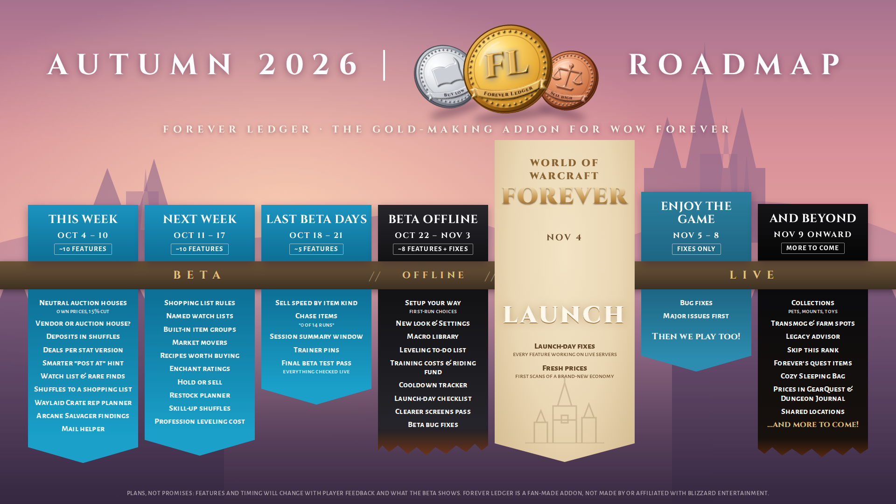

# Forever Ledger roadmap

What's planned for Forever Ledger. These are plans, not promises: the order changes with what players find useful, and anything that depends on how WoW Forever works gets tested first. Ideas and feedback are welcome: use **/feature** on our [Discord](https://discord.gg/WKsCtvupeC), or open an [issue](https://github.com/ivellos/forever-ledger/issues).

What's already in the addon is in the [changelog](CHANGELOG.md). Download: [Releases](https://github.com/ivellos/forever-ledger/releases).

## Being tested now

- **Gold making, one list**: in the addon since 0.27.0: every way to make gold the addon finds in one tab (crafts that sell, conversions, vendor flips, deals, disenchanting, Booty Bay), with filters you can save, and for a craft the cheapest way to get its materials for the number you'll make: the few cheap listings bought, the rest made from their own materials where that's cheaper, nothing counted twice. Replaces the Shuffles and Deals tabs.
- **Your language**: in the addon since 0.28.0: text in Simplified Chinese, and Russian since 0.29.0 (more languages welcome), and everything that reads the game works on clients in any language.
- **Arcane Salvager**: measuring how much it really improves disenchanting (nothing official says), then a plan for using it well: saving up greens and disenchanting them in 15-minute Salvager windows when the extra materials are worth more than the Salvager costs.
- **Neutral auction houses**: in the addon since 0.15.0 (Booty Bay prices kept as their own market, the 15% cut in the math, and a Booty Bay view, now a button on Gold making). Next: items only one faction can buy, to sell to the other side.
- **Where recipes come from**: original Classic vendor, drop and trainer locations are shown as "(Classic)" until players confirm them in Forever.
- **Sell speed**: a rating per item (Fast, Steady, Slow, Rare, No sales seen), judged against items of the same kind, from listings that vanished before they could have expired. In the addon now and building up data; next: comparing items against each other within their kind, and spotting patches that change what sells.

## Gold making

- **Waylaid Crates**: the cheapest way to raise Commerce Authority reputation at today's prices, buying crates and materials across the cheapest listings.
- **Shuffles to a shopping list**: in the addon since 0.15.0, with the Disenchant finder's items too and each price limit's source shown (the shuffle, your usual price plus an allowance, or your own).
- **Shopping list rules**: besides single items, rules like "green armor up to 4s" or "level 29 BoE gear for rogues", and importing Auctionator shopping lists.
- **Shopping lists, simpler**: in the addon since 0.11.0: one kind of list with a one-click "Search all" (including specific versions, "of the Monkey") and what you own across your characters; tick one box to buy from it in the Buy queue, with the cost of the rest, and craft or buy, whichever is cheaper.
- **Item groups, built in**: in the addon since 0.27.0 (the Groups tab, with post, buy, vendor and craft rules for each group): ready-made groups (cloth, herbs, ores, enchanting materials, recipes, transmog gear and more) with sensible buy and sell rules, filled from the game's own item data and kept up to date with patches. No setup and no import strings; change any rule if you want to.
- **Watch list and rare finds**: watched items are in the addon since 0.20.0 (items you're after with the most you'd pay, looked for every time Live watch reads the auction house, and bought first from the Buy queue). Next: alerts for items that are almost never listed and for valuable items listed well under their usual price.
- **Your auctions**: in the addon since 0.12.0 (undercut alerts, Cancel next undercut, sold and gold on the way), and what sold while you were away since 0.14.0.
- **Vendor or auction house?**: in the addon since 0.24.0 as the sell suggestion in your bags' tooltips (keep, vendor, auction house, or disenchant). Next: the same on the Sell tab for everything in your bags at once, with a one-click list to vendor the rest.
- **Deals per stat version**: judge "of the Monkey" against other Monkey versions, not the item as a whole.
- **Which recipes are worth buying**: a recipe's cost (gold or Merchant's Favor) against its profit per craft and how often you'd make it.
- **Price gaps**: materials whose cheapest few listings sit far below the next price, to buy and relist just under it, in their own view in the Buy window.
- **Sell chance**: how likely an item is to sell rather than expire, worked out from your own scans (no app or account), and your own sale rate: of what you posted in the last week, how much sold, expired or was cancelled.
- **Market movers**: items whose price jumped or crashed since the last patch.
- **More for deals**: sell speed in item tooltips too, a restock planner and named watch lists.
- **"Post at" hint**: the price helper on the Sell tab is in the addon since 0.13.0 (usual price, cheapest now, Undercut and Usual buttons), and since 0.27.0 the Post tab prices everything in your bags from the listings and each group's post rule (match the cheapest, or always undercut by your amount). Next: suggest matching the cheapest for materials (the newest listing at a price sells first) and undercutting for gear.
- **Collections: pets, mounts and toys** (and appearances if transmog arrives): what you have, what you're missing and how to get each one, including Forever's new ones, plus the gold side: what tradeable ones sell for and which are worth farming.
- **Auction house deposits**: count the deposit in shuffles that end on the auction house, so cheap items that cost more to post than they earn show as "vendor it instead".
- **Transmog**: bind-on-equip items that sell well, what they're worth and where they drop, including "worth farming" per rare.
- **Quest turn-in items**: in the addon now, from original Classic quests (tooltips list the quest and say "keep it" for your own leveling). Next: learning Forever's own quests from players' quest logs, and when these items sell best.
- **Launch-day checklist**: was the Leveling tab (0.16.0 to 0.24.0), taken out in November; it may come back in a separate leveling or farming companion.
- **Hold or sell**: price graphs are in the addon since 0.19.0 (the price window: 2 weeks, 3 months or a year, each gear version on its own). Next: saying when something is the cheapest or dearest it has been.
- **Auctionator**: send a shuffle's materials to an Auctionator shopping list, with the most worth paying as the maximum price.

## Leveling

- **Dungeon runs and chase items**: dungeon runs were taken out in November (the session tracker came back in 0.26.0, with a session window, Pause and Reset in 0.27.0); they may come back in a farming section (gold farms, runs, drops and items you are farming), possibly as a companion addon.
- **Leveling to-do list**: reminders that pop up at the right moment, for example "Level 14: time to get your Cozy Sleeping Bag".
- **Cozy Sleeping Bag**: whether the trip is worth it for your route and pace, and the best time to get it.
- **Training costs**: what the next levels of class and profession training will cost, so you can save for them.
- **Riding fund**: in the addon since 0.15.0 (how close you are to riding at 40 and epic riding at 60, mount included, and about how many days at your pace). Next: a warning when you spend into it.
- **Bag value**: in the addon since 0.14.0 (price per slot in bag tooltips, and the cheapest bag per slot).
- **Legacy advisor**: which Legacy perks pay off for how you play (priced from your own vendor, flight and Favor spending), and the cheapest route to your next point.

## Professions

- **Craftsman's Writs**: in the addon since 0.27.0 (every order, the cheapest way to fill it and the cost per reputation, with a shopping list). Next: the orders read from the game's own data instead of player guides.
- **Enchant ratings**: which enchants are worth making and selling.
- **Trainers**: pin the nearest trainer of the tier you need.
- **Cooldown tracker**: profession and camping cooldowns across your characters.
- **Profession leveling cost**: the cheapest way to your next skill milestone at today's prices.
- **Skill-up shuffles**: mark shuffles that also level your profession, and show the ones that only break even when the skill-ups are worth it ("levels Tailoring and Enchanting for about free").

## Quality of life

- **Setup your way**: a short first-run setup that asks what you want: everything in one click, or pick the parts you'll use (gold making, shopping lists, crafting, crates, and more later), a few options for each, your look and tooltips, and what to switch off if you also use Auctionator, TSM or similar. Parts you turn off don't run at all. Run it again any time.
- **Clearer screens**: a regular pass over every window for wording, layout and "what do I click", led by player feedback. A first-run welcome and "What's new" after each update are in the addon now.
- **Your characters' bags and bank, and what they're worth**: in the addon since 0.13.0 (Characters tab).
- **Mail helper**: open all mail in one click (sales logged as it goes), and a warning when one mail carries many stacks.
- **Scan status you can see**: a clearer sign of when a scan is running and when it's done, wherever you are (a player's suggestion).
- **AHledger prices**: in the addon since 0.27.0: with the AHledger addon installed, its prices fill in where your own scans are missing or old, credited wherever they're used.
- **Plays nice with Auctionator and TSM**: features they already cover are switched off when they're installed, with a one-time message saying what and how to turn them back on. Later also Leatrix Plus and ForeverForge, for auto-selling and sniping.
- **Prices for other addons' lists**: what GearQuest's suggested upgrades cost on the auction house right now, and what Dungeon Journal's boss loot is worth per run, when those addons are installed.
- **A new look and a new Settings window**: in the addon since 0.14.0 (three themes, accent colors, Size, the new Settings with profiles). Next: looks based on WoW Forever's own windows and on Blizzard's.
- **Shopping list** across shuffles.
- **Macro library**: a searchable library of useful macros by class and purpose, each explained, with one-click "create". Players will be able to suggest macros on the Discord and vote for the most useful ones.

## Community data

- **Shared locations**: addon users can share where vendors and trainers are and what they sell, so everyone's recipe and trainer data fills in faster. World facts only (no names, gold or bags); it will ask before turning on, and you can turn it off. Not built yet: today nothing is shared.
